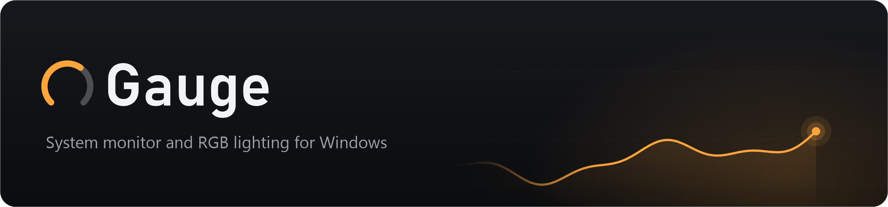
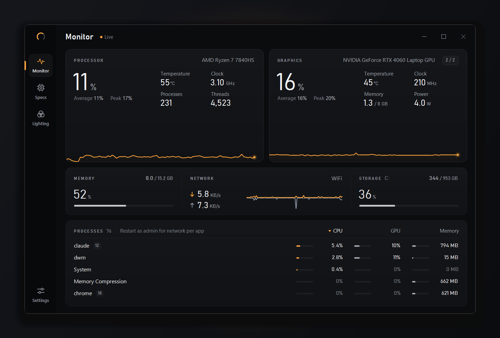
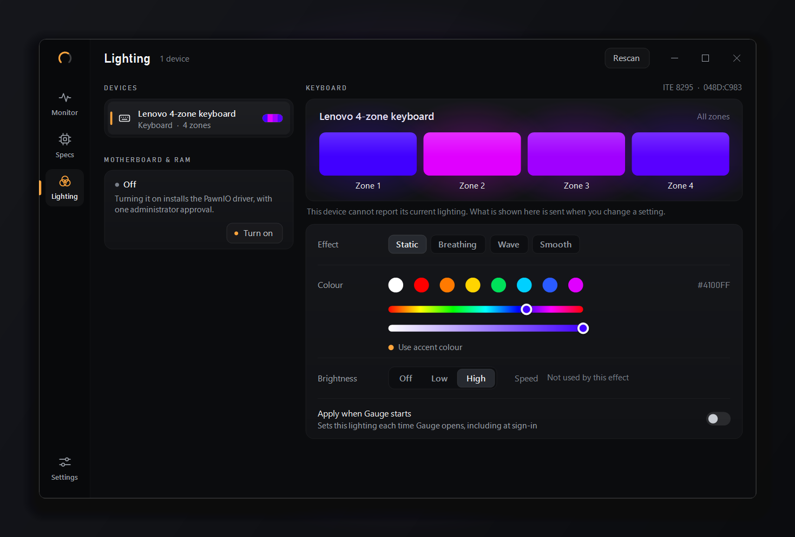
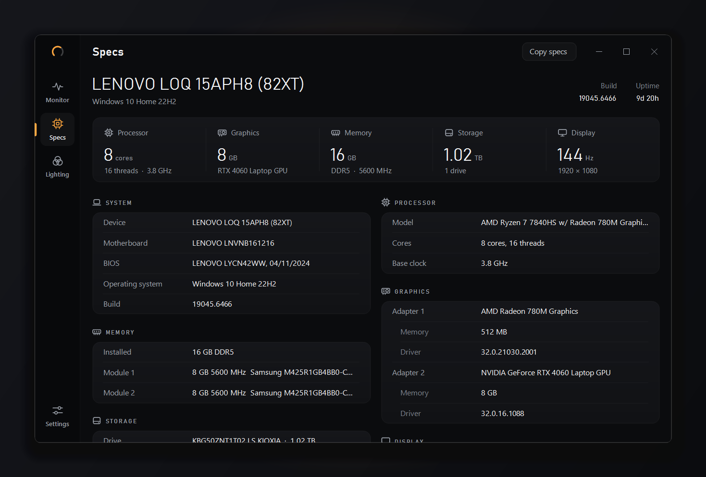
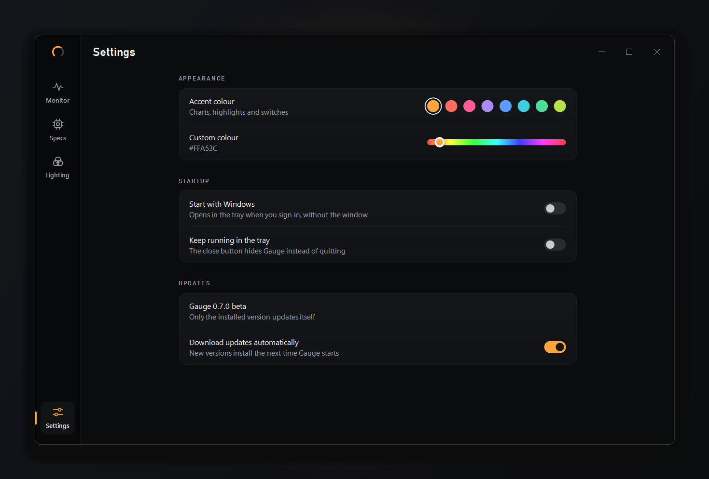

<p align="center">
  
</p>

<p align="center">
  A lightweight system monitor and RGB lighting controller for Windows.<br>
  No account, no telemetry, no vendor apps. About 40 MB of memory.
</p>

<p align="center">
  <a href="https://github.com/Manny912-dev/Gauge/releases/latest/download/Gauge-win-Setup.exe"><b>Download for Windows</b></a>
  &nbsp;·&nbsp;
  <a href="https://github.com/Manny912-dev/Gauge/releases">All releases</a>
  &nbsp;·&nbsp;
  <a href="CHANGELOG.md">Changelog</a>
</p>

<p align="center">
  
</p>

## Features

### Monitor
- CPU and GPU load with 90 seconds of history, plus temperature, clock, power, fan and video memory where the hardware reports them
- Temperatures that turn amber and red as they get hot
- Memory, network (download and upload, charted) and storage at a glance
- A process list grouped by app, sortable by CPU, GPU or memory; run as administrator for per-app download and upload speeds
- Switch between GPUs on machines with more than one

### Lighting
- Control RGB devices without the maker's software: keyboards, mice, headsets, graphics cards, coolers, fan and LED controllers
- A native driver for Lenovo Legion, LOQ and IdeaPad Gaming 4-zone keyboards, and a built-in [OpenRGB](https://openrgb.org) engine for hundreds of other devices, found automatically
- Per-zone colours, each device's own effects, brightness and speed, with a live preview
- Motherboard and RAM lighting with one administrator approval (installs the [PawnIO](https://github.com/namazso/PawnIO.Setup) driver), and a clean way to turn it off again
- "Apply when Gauge starts" sets your lighting at every sign-in
- Devices without a driver yet are listed, with a report you can copy and send so support can be added

### Specs
- A complete hardware inventory, detected automatically: system, processor, graphics, memory modules, storage, display and network
- "Copy specs" puts it all on the clipboard as text, ready for a forum post or support ticket

### Everyday
- Start with Windows, straight to the notification area, and keep running in the tray when closed
- Updates download quietly in the background and install the next time Gauge starts (can be switched off)
- Eight accent colours or any hue you like
- A custom-drawn interface that stays light: no web view, no background services

<p align="center">
  
</p>

<table>
  <tr>
    <td></td>
    <td></td>
  </tr>
</table>

## Install

1. Download **[Gauge-win-Setup.exe](https://github.com/Manny912-dev/Gauge/releases/latest/download/Gauge-win-Setup.exe)** and run it. Gauge installs for your user account only, so no administrator rights are needed.
2. Windows may show "Windows protected your PC" the first time, because Gauge is not code-signed yet. Click **More info**, then **Run anyway**.

Requires 64-bit Windows 10 or Windows 11. The installed copy keeps itself up to date. Each release also has a portable zip (`Gauge-win-Portable.zip`) for running without installing.

If you turned on motherboard and RAM lighting, turn it off in Gauge before uninstalling.

## What's new

**0.7.0** — A full redesign on the way to 1.0: a navigation rail, a bigger and clearer Monitor page, a rebuilt Lighting page (device list plus inspector, with a glowing live preview), grouped Specs, and Settings as its own page.

**0.6.1** — Rounded window corners on Windows 11.

**0.6.0** — Start with Windows (straight to the tray) and keep running in the tray when closed.

See the [changelog](CHANGELOG.md) for details.

## Privacy

Gauge has no account and sends nothing about you or your PC anywhere. Its only network use is checking GitHub for its own updates, which you can switch off in Settings. Settings and a diagnostic log stay on your PC in `%AppData%\Gauge`.

## Building from source

You need Windows and the [.NET 10 SDK](https://dotnet.microsoft.com/download).

```
git clone https://github.com/Manny912-dev/Gauge.git
cd Gauge
dotnet build -c Release
```

The app is written in C# with Windows Forms, but nothing on screen is a standard control: every page is drawn with GDI+ by `Renderer.cs` and `RendererLighting.cs`.

**Lighting engine.** For devices handled through OpenRGB, unpack the official [OpenRGB 1.0](https://openrgb.org/releases.html) Windows 64-bit build into `third-party/openrgb-1.0/OpenRGB Windows 64-bit/`; the build copies it next to Gauge as `engine`. Without it Gauge still builds and runs, with the native Lenovo keyboard driver only.

**Packages.** `release.ps1` builds the installer, the zip and the [Velopack](https://velopack.io) update feed (it needs the `vpk` tool: `dotnet tool install -g vpk`). It publishes to GitHub only when the `GAUGE_GITHUB_REPO` and `VPK_TOKEN` user environment variables are set; use `-NoUpload` to build without publishing.

**Developer flags** (run `Gauge.exe` with one of these):

| Flag | What it does |
|---|---|
| `--snapshot <folder>` | Renders every page to PNG offscreen with live data, plus sensor readings and a lighting device report |
| `--tray-menu <file.png>` | Opens the tray menu and saves a picture of it |
| `--banner <file.png>` | Draws the README banner (`docs/banner.png`) |
| `--orgb-test <file>` | Sends colours to every OpenRGB device and reads them back |
| `--light-test <RRGGBB> <file>` | Sends one colour to the native keyboard driver |
| `--board-lighting dryrun` | Writes the motherboard and RAM setup plan to `%TEMP%` without changing anything |

### Project layout

| File | Purpose |
|---|---|
| `Program.cs` | Entry point: update hook, developer flags, single instance |
| `MainForm.cs` | The borderless window, input, tray behaviour |
| `Renderer.cs` | Design tokens, the rail and header, Monitor, Specs and Settings pages |
| `RendererLighting.cs` | The Lighting page |
| `Telemetry.cs`, `Processes.cs`, `NetTrace.cs`, `Pdh.cs`, `Nvml.cs` | Sensors: LibreHardwareMonitor, NVML, performance counters, process and network sampling |
| `Specs.cs` | Hardware inventory |
| `Lighting.cs`, `OpenRgb.cs`, `BoardLighting.cs` | Lighting model, native keyboard driver, OpenRGB client and engine, motherboard and RAM setup |
| `Updater.cs`, `Startup.cs`, `Tray.cs`, `Settings.cs` | Updates, start with Windows, tray icon, settings file |

## License

Gauge is released under the [MIT License](LICENSE).

It ships with third-party components under their own licences, listed in [THIRD-PARTY-NOTICES.txt](package/THIRD-PARTY-NOTICES.txt). Notably, OpenRGB (GPL-2.0-or-later) is included unmodified and run as a separate program; the exact source of the bundled build is published as the [openrgb-1.0-source](https://github.com/Manny912-dev/Gauge/releases/tag/openrgb-1.0-source) release. Sensor reading uses [LibreHardwareMonitor](https://github.com/LibreHardwareMonitor/LibreHardwareMonitor) (MPL-2.0).
